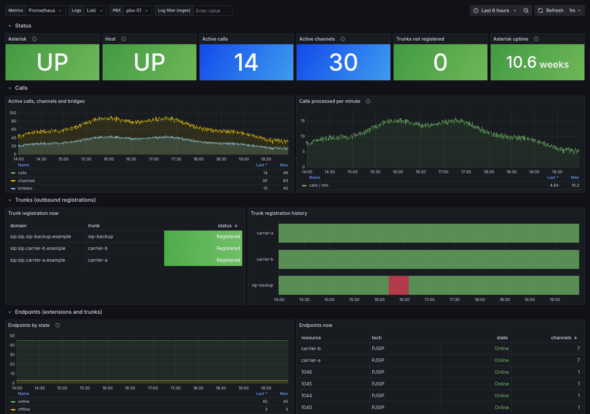
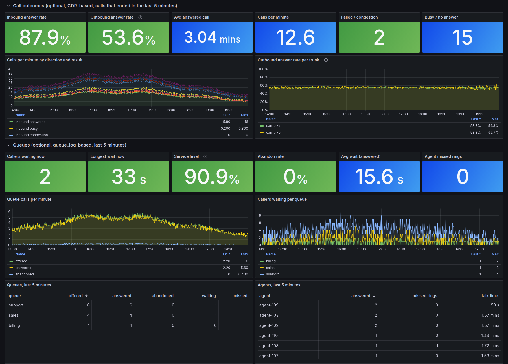
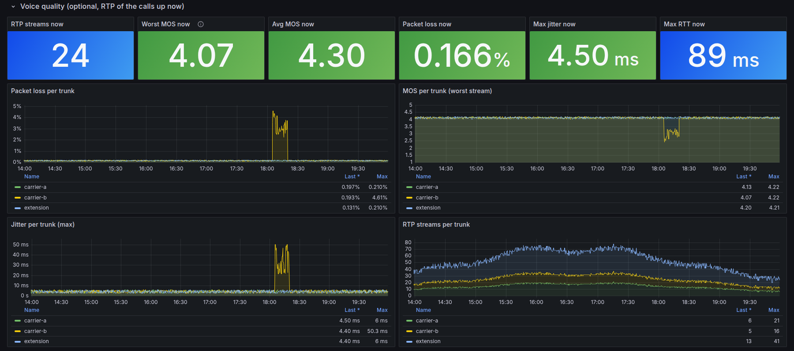
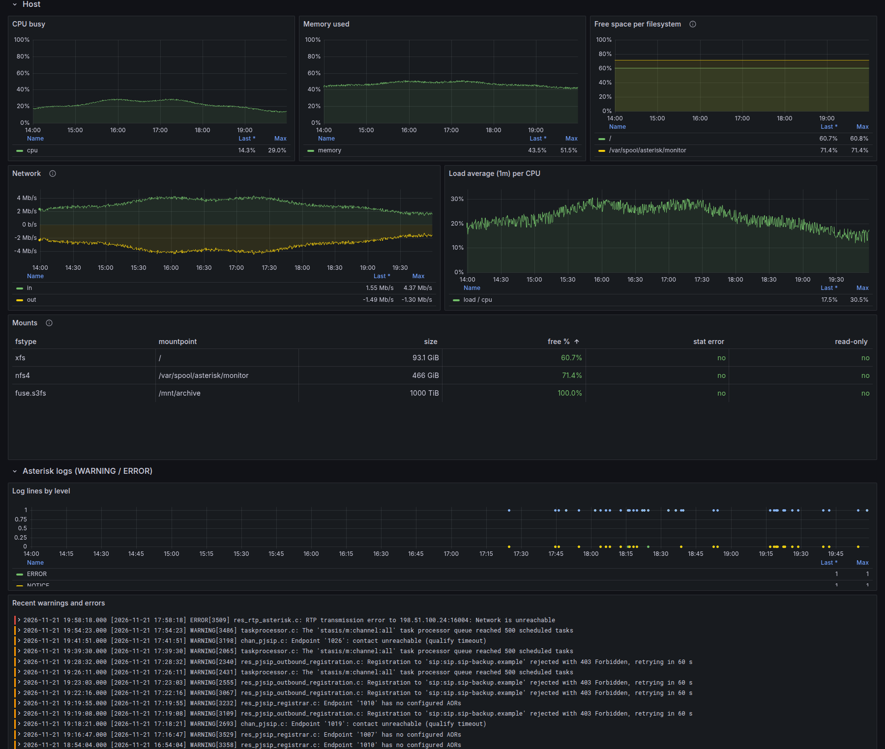

# Asterisk / FreePBX Grafana dashboard

[](https://grafana.com/grafana/dashboards/26099)

One Grafana dashboard for Asterisk-based PBXs (plain Asterisk, FreePBX, Issabel, ...): is Asterisk up, how many calls, are the trunks registered, which endpoints are offline, how the host is doing, and what Asterisk is complaining about. Optional rows add queue performance, voice quality and call outcomes if you export those numbers too.



All screenshots use synthetic demo data (`pbx-01`, `carrier-a`, `*.example` domains).

## What you get

| Row | Shows | Needs |
|---|---|---|
| Status | Asterisk up, host up, active calls and channels, trunks not registered, Asterisk uptime | `res_prometheus`, `node_exporter` |
| Calls | Active calls / channels / bridges, calls processed per minute | `res_prometheus` |
| Trunks | Registration state per trunk now, and its history | `res_prometheus` |
| Endpoints | Online / offline endpoints over time, per-endpoint state and channels | `res_prometheus` |
| Call outcomes *(optional)* | Answer rate in / out, average call length, failed and busy calls, answer rate per trunk | your own CDR-based metrics ([contract](#optional-metrics-contract)) |
| Queues *(optional)* | Callers waiting, longest wait, service level, abandon rate, per queue and per agent | your own `queue_log`-based metrics |
| Voice quality *(optional)* | Packet loss, jitter, round-trip time and estimated MOS per trunk | your own RTP metrics |
| Host | CPU, memory, free space per filesystem, network, load, mounts (incl. stale NFS) | `node_exporter` |
| Logs | Asterisk WARNING / ERROR lines and their rate | Loki (optional) |

Optional rows show a grey `n/a` when their metrics are missing, so the dashboard works with only the core sources.

<details><summary>More screenshots</summary>





</details>

## Requirements

* Grafana 10 or newer.
* A Prometheus-compatible metrics store (Prometheus, Mimir, VictoriaMetrics, Thanos, Grafana Cloud...).
* Loki, only for the logs row.
* Asterisk 17 or newer for `res_prometheus` (older versions: see [tips](#tips)).

## The one rule: a `pbx` label

The dashboard picks a PBX with a `pbx` variable and filters every query by it. So every series from one PBX must carry the same `pbx` label, whatever exports it:

| Source | Job name the dashboard expects | Labels |
|---|---|---|
| Asterisk `res_prometheus` | `job="asterisk"` | `pbx="<name>"` |
| `node_exporter` | `job="node"` | `pbx="<name>"` |
| Asterisk log in Loki | `job="asterisk"` | `pbx="<name>"` |
| Optional metrics | any | `pbx="<name>"` |

Add it in your scrape config (static labels or relabelling) or as an external label on the agent that runs on the PBX. Use a short stable name (`pbx-01`, `office-london`), not the IP: cloned servers often share a hostname.

## Exporting the core metrics

### 1. Asterisk: `res_prometheus`

Asterisk ships its own Prometheus endpoint since version 17. It needs Asterisk's built-in HTTP server (`http.conf`, default port 8088) and a `prometheus.conf`:

```ini
; /etc/asterisk/prometheus.conf
[general]
enabled = yes
core_metrics_enabled = yes
uri = metrics
auth_username = metrics
auth_password = <a long random password>
auth_realm = Asterisk Prometheus Metrics
```

Then `asterisk -rx 'module load res_prometheus.so'` (or `module reload` if it is already loaded). This doesn't restart Asterisk or touch calls. Check with `asterisk -rx 'prometheus show status'` and `curl -u metrics:... http://127.0.0.1:8088/metrics`.

Metrics the dashboard uses:

| Metric | Meaning |
|---|---|
| `asterisk_calls_count`, `asterisk_channels_count`, `asterisk_bridges_count` | Calls, channels and bridges up now |
| `asterisk_calls_sum` | Calls processed since start (a counter) |
| `asterisk_core_uptime_seconds` | Time since Asterisk started |
| `asterisk_pjsip_outbound_registration_status{username,domain}` | Trunk registration: 0 unregistered, 1 registered, 2 rejected |
| `asterisk_endpoints_state{resource,tech}`, `asterisk_endpoints_channels_count` | Endpoint state (2 online, 1 offline, 0 unknown) and channels in use |

Scrape it every 30 s with Basic Auth. Drop `asterisk_channels_state` and `asterisk_channels_duration_seconds`: they create one new series per call and grow your database for no benefit.

```yaml
# Prometheus scrape config (example)
scrape_configs:
  - job_name: asterisk
    basic_auth: {username: metrics, password_file: /etc/prometheus/asterisk-metrics.pw}
    static_configs:
      - targets: ["pbx-01.example:8088"]
        labels: {pbx: pbx-01}
    metric_relabel_configs:
      - source_labels: [__name__]
        regex: asterisk_channels_(state|duration_seconds)
        action: drop
  - job_name: node
    static_configs:
      - targets: ["pbx-01.example:9100"]
        labels: {pbx: pbx-01}
```

If you run an agent on the PBX instead (Grafana Alloy, Prometheus agent, OpenTelemetry Collector), scrape `127.0.0.1:8088` locally and set `pbx` as an external label. Then the Asterisk HTTP server never needs to be reachable from outside.

### 2. Host: `node_exporter`

The default collectors are enough. The dashboard uses CPU, memory, filesystem, network and load metrics. Bucket mounts (`fuse.*`) are left out of free-space panels because they report a fake size; the mounts table still shows them, so a hung mount stands out.

### 3. Logs (optional): Loki

Ship `/var/log/asterisk/full` (or `messages`) with labels `job="asterisk"` and `pbx`, and keep only WARNING and ERROR lines on the agent. The full log is huge and mostly VERBOSE. Asterisk recreates the log on rotation, often as `0640 asterisk:asterisk`: give your agent read access with an ACL (`setfacl -d -m u:<agent>:r /var/log/asterisk`) rather than the `asterisk` group, which can usually read `/etc/asterisk` (secrets) too.

## Optional metrics contract

These rows are for numbers Asterisk doesn't export itself. Produce them any way you like (a small collector that writes a Prometheus textfile, an exporter, a recording rule), as long as the names and labels match. `*_5m` metrics are gauges: the count over the last 5 minutes, recomputed every minute. Use them for ratios and per-minute rates, never sum them over time.

### Call outcomes (from CDRs)

| Metric | Labels | Meaning |
|---|---|---|
| `asterisk_cdr_calls_5m` | `direction` (inbound, outbound, internal), `trunk`, `disposition` (answered, no_answer, busy, failed, congestion) | Calls that ended in the last 5 minutes, one per call |
| `asterisk_cdr_answered_seconds_5m_sum` | `direction`, `trunk` | Total talk time (billsec) of those answered calls |
| `asterisk_cdr_trunk_attempts_5m` | `trunk`, `disposition` | Every outbound attempt per trunk, failover attempts included |

### Queues (from `queue_log`)

| Metric | Labels | Meaning |
|---|---|---|
| `asterisk_queue_offered_5m`, `_answered_5m`, `_abandoned_5m` | `queue` | `ENTERQUEUE`, `CONNECT`, `ABANDON` events |
| `asterisk_queue_answered_within_sl_5m` | `queue` | `CONNECT` with wait time within your service-level target |
| `asterisk_queue_wait_seconds_5m_sum` | `queue` | Sum of wait times of answered calls (`CONNECT` data1) |
| `asterisk_queue_ring_no_answer_5m` | `queue` | `RINGNOANSWER`: an agent was rung and didn't pick up |
| `asterisk_queue_waiting`, `asterisk_queue_longest_wait_seconds` | `queue` | Callers waiting now and the longest wait |
| `asterisk_queue_agent_answered_5m`, `_agent_ring_no_answer_5m`, `_agent_talk_seconds_5m_sum` | `agent` | Per-agent view |

### Voice quality (RTP of the calls up now)

| Metric | Labels | Meaning |
|---|---|---|
| `asterisk_rtp_streams` | `trunk` | RTP streams measured |
| `asterisk_rtp_packets`, `asterisk_rtp_lost_packets` | `trunk`, `direction` (rx, tx) | Packets and lost packets of those streams |
| `asterisk_rtp_jitter_seconds_max` | `trunk`, `direction` | Worst jitter |
| `asterisk_rtp_rtt_seconds_max` | `trunk` | Worst round-trip time (where available) |
| `asterisk_rtp_mos_min`, `asterisk_rtp_mos_avg` | `trunk` | Estimated MOS (1 to 5) from loss, jitter and RTT |

Sources: `pjsip show channelstats` and `sip show channelstats` (read-only CLI commands) show packets, loss, jitter and RTT per live call.

## Tips

Lessons from running this on production PBXs.

**Safety on a live PBX**
* Read-only everything: `show` commands, reading files Asterisk already writes, `SELECT` queries. Nothing in this dashboard needs a change to Asterisk beyond loading `res_prometheus`, and loading or reloading a module doesn't drop calls.
* Run the monitoring agent as its own service with CPU and memory limits, so it can never compete with Asterisk.
* Don't add an AMI client just for metrics on a busy box: every connected client receives every event, and a slow one makes Asterisk queue events in memory.

**Labels**
* Keep labels bounded: trunk names, queue names, agent names. Never caller numbers, channel names or call IDs.
* Group phones under one value (e.g. `trunk="extension"`) in the voice-quality metrics, or every extension becomes a series.

**CDRs**
* Query the CDR table with a time range on `calldate` (it is indexed), and cap the query time: `MAX_EXECUTION_TIME` on MySQL 5.7.8+, `max_statement_time` on MariaDB 10.1+, or a watchdog that runs `KILL QUERY` on its own connection on older servers. A query of the last 2 hours takes tens of milliseconds even on tables with tens of millions of rows.
* Use a dedicated read-only database user (`SELECT` on the CDR table only), not the PBX's application user or root.
* Don't query CEL tables for metrics unless they have an index on the event time: a full scan of a large CEL table can run for minutes.
* Group rows by `linkedid` to count calls, not legs: a queue call creates one CDR row per agent rung.

**queue_log**
* Dialers and CRMs often write their own events into `queue_log` (`BUSY`, `NOANSWER`, `CANCEL`...). Treat those as ending the wait, or "callers waiting" climbs forever.
* If you ship `queue_log` to Loki, redact caller IDs on the agent. They come in odd formats (`+<country code>...`, invisible Unicode direction marks), so redact the whole caller-ID field, not just digit-only values.

**Voice quality**
* Remote RTCP reports can be garbage: a lost-packet counter that wrapped around, or jitter in the wrong units. Drop impossible values (loss above packets sent, jitter over a second) instead of letting one bad report turn your MOS panel red.
* `chan_sip` shows peer names and call IDs truncated in its CLI output; match them against the full names from `core show channels concise`.

**Older Asterisk (before 17)**
* No `res_prometheus`. You can still feed the core panels: run read-only `asterisk -rx` commands (`core show channels count`, `core show uptime seconds`, `sip show peers`, `sip show registry`) from a timer and write the results under the same metric names as `res_prometheus`. The dashboard won't know the difference.
* Each `asterisk -rx` logs a connect and disconnect line, so once a minute is plenty.

## Suggested alerts

Starting points; tune the thresholds to your traffic.

| Alert | PromQL |
|---|---|
| Asterisk down | `up{job="asterisk"} == 0` for 2m |
| PBX stopped reporting | `absent_over_time(up{job="node", pbx="pbx-01"}[5m])`, or compare against a recording rule that lists your PBXs |
| Trunk not registered | `asterisk_pjsip_outbound_registration_status != 1` for 5m |
| Static trunk peer unreachable | `asterisk_endpoints_state{resource!~"[0-9]+"} == 1` for 5m, only for peers that were online recently: `and on (pbx, resource) max_over_time(asterisk_endpoints_state[7d]) == 2` |
| Asterisk restarted | `asterisk_core_uptime_seconds < 600` |
| Disk filling up | `node_filesystem_avail_bytes / node_filesystem_size_bytes < 0.15` for 15m (warning), `< 0.05` (critical) |
| Mount not answering | `node_filesystem_device_error == 1` for 5m |
| Queue abandon rate high *(optional)* | `sum by (pbx, queue) (asterisk_queue_abandoned_5m) / sum by (pbx, queue) (asterisk_queue_offered_5m) > 0.2` and offered > 10 |
| Packet loss on a trunk *(optional)* | `sum by (pbx, trunk) (asterisk_rtp_lost_packets) / sum by (pbx, trunk) (asterisk_rtp_packets + asterisk_rtp_lost_packets) > 0.02` for 5m |
| Outbound answer rate collapsed *(optional)* | answered / all `asterisk_cdr_trunk_attempts_5m` per trunk `< 0.2` with at least 20 attempts |

## Install

1. Grafana → Dashboards → New → Import → enter the ID **`26099`** and click Load ([grafana.com page](https://grafana.com/grafana/dashboards/26099)), or upload [`dashboard/asterisk-freepbx-overview.json`](dashboard/asterisk-freepbx-overview.json).
2. Pick your Prometheus-compatible and Loki data sources when asked; you can switch them later with the **Metrics** and **Logs** drop-downs at the top.
3. Pick a PBX.

## License

[MIT](LICENSE)
